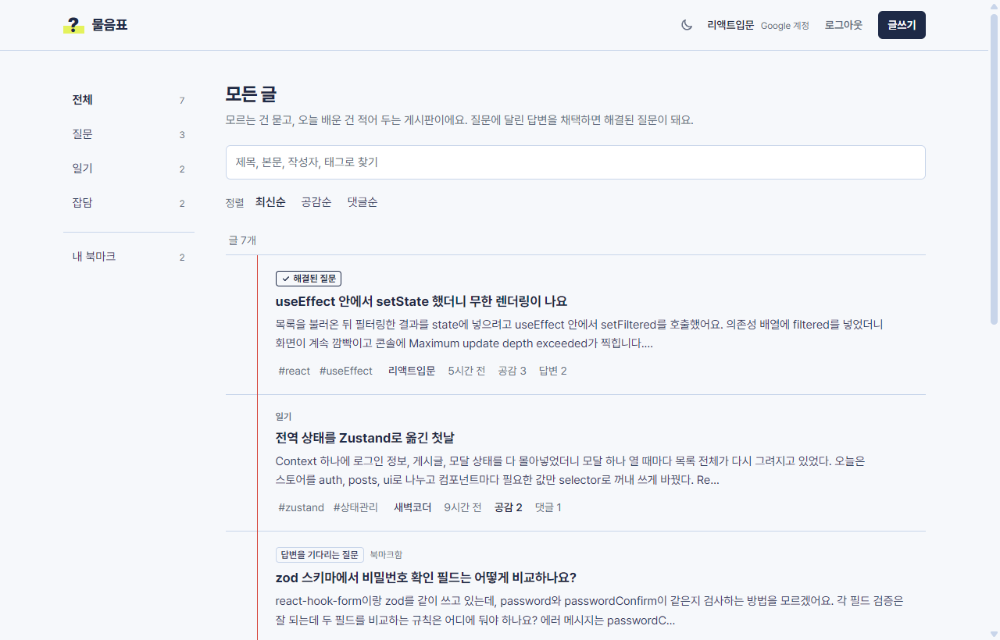
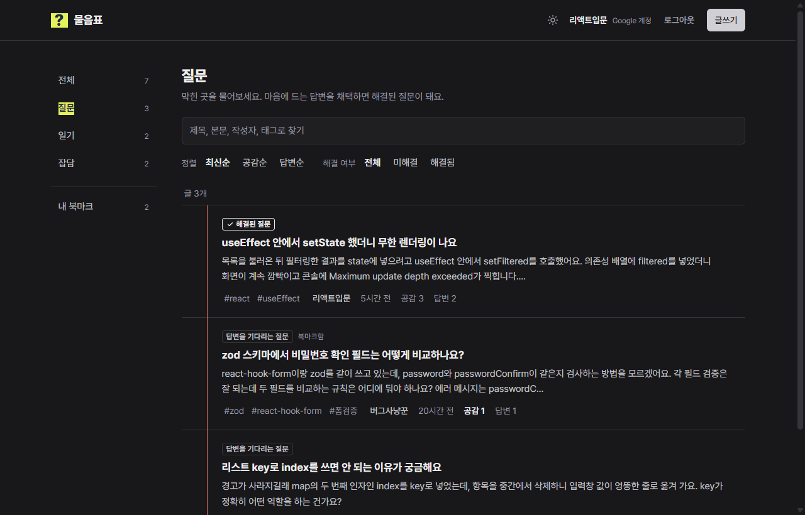
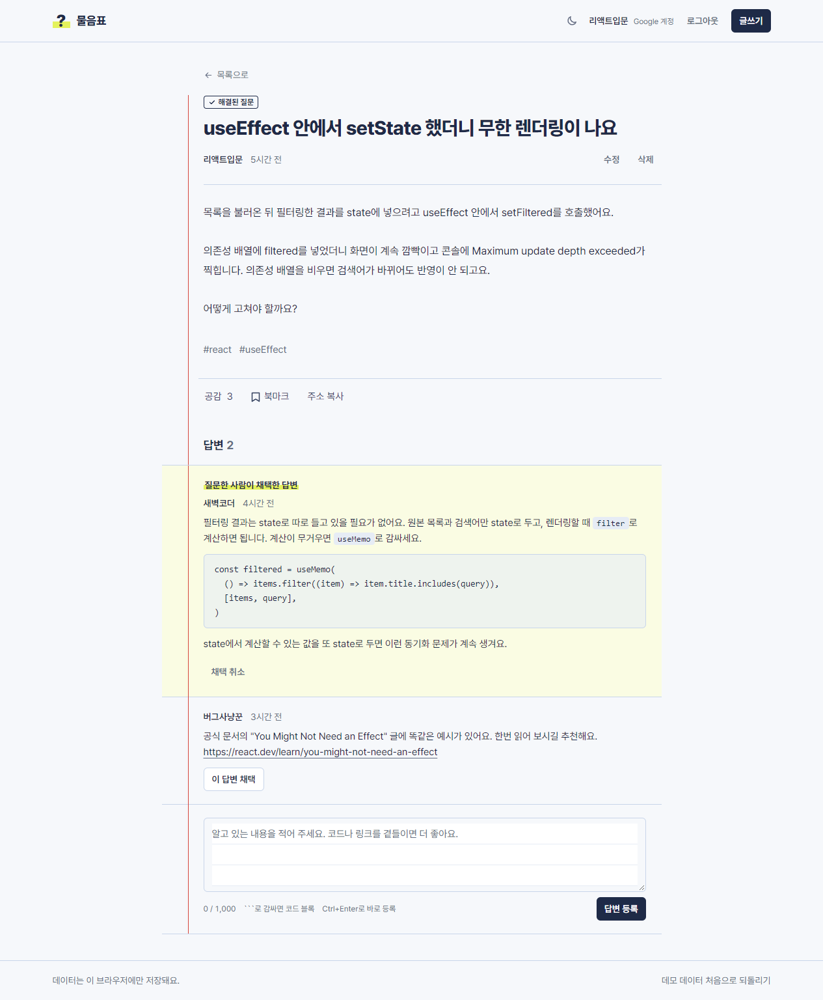
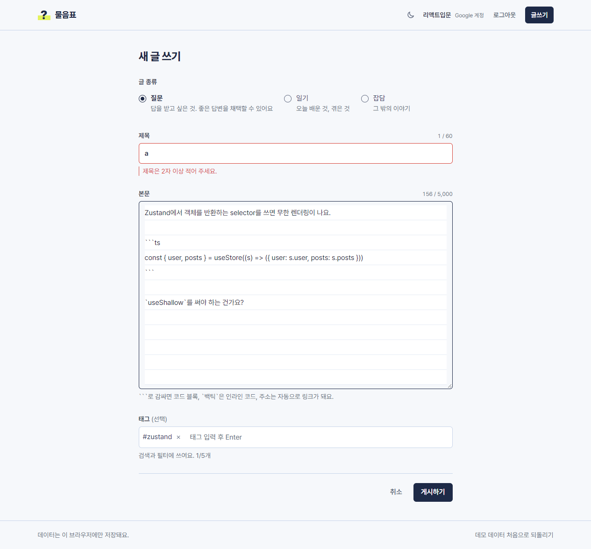

# 물음표 게시판

모르는 건 묻고 오늘 배운 건 적어 두는 Q&A 커뮤니티입니다. React로 "상태를 어디에 둘 것인가"를 제대로 고민해 보고 싶어서 혼자 만든 학습용 프로젝트입니다. 게시판은 기능이 단순해 보여도 상태 설계를 연습하기에 좋은 주제였습니다. 목록과 상세 화면이 같은 데이터를 나눠 쓰고 로그인 여부에 따라 할 수 있는 일이 달라지는 데다 폼 입력도 많기 때문입니다.

## 화면

| 글 목록 | 다크 모드 |
| --- | --- |
|  |  |

| 채택된 답변과 코드 서식 | 글쓰기와 폼 검증 |
| --- | --- |
|  |  |

## 실행 방법

```bash
npm install
npm run dev      # 개발 서버 (http://localhost:5173)
npm run build    # 타입 체크 후 dist/에 빌드
npm run lint
```

별도 서버 없이 브라우저만으로 동작합니다. 데이터는 localStorage에 저장됩니다. 화면 맨 아래 "데모 데이터 처음으로 되돌리기"를 누르면 예시 글만 남은 처음 상태로 돌아갑니다.

## 주요 기능

| 기능 | 내용 |
| --- | --- |
| 게시글 | 질문·일기·잡담 세 종류로 쓰고 읽고 고치고 지울 수 있습니다. 쓰는 도중 다른 페이지로 나가려 하면 확인 창이 뜹니다. |
| 댓글과 답변 채택 | 댓글은 그 자리에서 바로 고칠 수 있습니다. 질문을 올린 사람이 답변 하나를 채택하면 글이 "해결된 질문"으로 바뀝니다. |
| 검색과 필터 | 제목·본문·작성자·태그로 찾습니다. 글 종류·해결 여부·태그로 거르고 최신순·공감순·답변순으로 정렬합니다. 찾은 단어에는 형광펜이 그어집니다. |
| 코드 서식 | 본문과 댓글에서 ```로 감싼 코드 블록과 `백틱` 인라인 코드를 고정폭 글꼴로 보여 줍니다. 주소는 자동으로 링크가 됩니다. |
| 공감과 북마크 | 누르는 즉시 화면이 바뀌고 요청이 실패하면 원래대로 돌아갑니다. 북마크한 글은 따로 모아 볼 수도 있습니다. |
| 소셜 로그인 | Google·GitHub·카카오 버튼으로 가상 로그인을 합니다. 처음 들어온 사람은 닉네임을 정하는데, 이미 있는 닉네임인지는 서버 응답으로 확인합니다. |
| 다크 모드 | 처음에는 운영체제 설정을 따르다가 헤더 버튼으로 바꾼 뒤에는 그 선택을 기억합니다. |

## 이 프로젝트로 공부한 것

### 1. 상태마다 알맞은 자리 찾기

처음에는 모든 상태를 전역 스토어 하나에 넣으려 했습니다. 그런데 상태를 하나씩 따져 보니 성격이 전부 달라서 아래처럼 나눴습니다.

| 상태 | 둔 곳 | 이렇게 둔 이유 |
| --- | --- | --- |
| 로그인 사용자 | Zustand + persist | 앱 어디서나 쓰고 새로고침해도 남아 있어야 해서 |
| 게시글 | Zustand (`id → 글` 형태로 저장) | 목록과 상세 화면이 같은 데이터를 보고 글 하나가 바뀌면 그 글만 교체하려고 |
| 댓글 | Zustand (글별로 따로) | 글을 열 때 불러오고 댓글 수와 채택 여부는 게시글 쪽에 반영 |
| 검색어·필터·정렬 | URL 주소 | 새로고침이나 링크 공유, 뒤로 가기를 해도 같은 목록이 보이게 |
| 화면에 보이는 목록 | 저장하지 않고 매번 계산 | 원본 글과 필터 조건만 있으면 만들 수 있는 값이라서 |
| 폼 입력값 | react-hook-form | 글자를 칠 때마다 페이지 전체가 다시 그려지지 않게 |

특히 "계산할 수 있는 값은 저장하지 않는다"는 원칙을 지키니 `useEffect`로 상태를 맞춰 주는 코드가 거의 사라졌습니다. Zustand에서는 컴포넌트마다 필요한 값만 꺼내 쓰는 selector를 써서 상관없는 상태가 바뀔 때 다시 그려지는 횟수를 줄였습니다.

### 2. 낙관적 업데이트

공감과 북마크는 서버 응답을 기다리지 않고 화면부터 바꿉니다. 요청이 실패하면 바꾸기 전 값으로 되돌리고 알림을 띄웁니다. 버튼을 빠르게 여러 번 누르면 요청이 꼬일 수 있습니다. 그래서 응답을 기다리는 동안에는 같은 버튼을 막았고, 서버에는 "누름/뗌" 토글 대신 "공감한 상태로 만들어 줘"처럼 원하는 결과를 보냅니다.

### 3. 폼 검증

검증 규칙과 TypeScript 타입은 zod 스키마 하나에서 함께 나옵니다. 처음에는 입력칸을 벗어날 때 검사하고 그다음부터는 칠 때마다 다시 검사합니다. 이렇게 하면 아직 다 쓰지도 않았는데 빨간 글씨부터 뜨는 일이 없습니다. 닉네임 중복처럼 서버만 알 수 있는 오류도 같은 자리에 같은 모양으로 보여 줍니다. 태그 입력에서는 한글을 조합하는 중에 Enter를 누르면 마지막 글자가 두 번 들어가는 문제를 만나서 `isComposing`으로 해결했습니다.

### 4. 서버를 갈아 끼울 수 있는 구조

`src/api/` 폴더가 가짜 서버 역할을 합니다. 요청마다 조금씩 지연을 넣어 두어서 로딩 상태도 실제처럼 보입니다. 스토어와 화면은 `postsApi.create()` 같은 함수만 부르기 때문에 나중에 진짜 백엔드를 붙일 때는 이 폴더만 바꾸면 됩니다.

### 5. 라이브러리 없이 안전하게 본문 서식 만들기

개발 질문에는 코드가 자주 들어가는데 처음에는 본문이 전부 일반 글자로만 보였습니다. 마크다운 라이브러리를 들이기보다 꼭 필요한 세 가지(코드 블록, 인라인 코드, 링크)만 정규식으로 잘라 내는 작은 컴포넌트를 직접 만들었습니다. 잘라 낸 조각은 HTML 문자열이 아니라 React 요소로 만들기 때문에 `dangerouslySetInnerHTML`을 쓰지 않습니다. 그래서 본문에 `<script>`를 적어도 실행되지 않고 글자로만 보입니다.

### 6. 디자인 토큰과 다크 모드

색을 `--color-ink`, `--color-paper` 같은 이름으로 정해 두고 컴포넌트에서는 이 이름만 썼습니다. 덕분에 다크 모드를 넣을 때 컴포넌트를 거의 건드리지 않고 토큰 값만 바꿔 끼울 수 있었습니다. 새로고침할 때 화면이 하얗게 번쩍이지 않도록 React가 뜨기 전에 테마를 먼저 적용하는 짧은 스크립트도 넣었습니다.

디자인 비평 도구로 화면을 점검해 보니 처음 만든 남색 다크 모드는 흔한 조합이라는 지적을 받았습니다. 후보 색 세 가지를 실제 화면에 입혀 비교한 끝에 무채색 먹색으로 바꿨습니다. 포인트 색인 형광펜도 "사용자가 직접 고른 값에만 긋는다"는 규칙을 정해 여기저기 흩어지지 않게 했습니다.

### 7. 접근성 기본기

입력칸과 오류 문구는 `aria-describedby`로 연결했습니다. 확인 창은 브라우저 기본 `<dialog>`를 써서 포커스 가두기와 Esc 닫기를 챙겼고 제목 id는 `useId`로 만들어 한 화면에 여러 개 있어도 겹치지 않습니다. 분류 탭은 버튼이 아니라 링크라서 새 탭으로 열거나 주소를 복사할 수 있습니다. 키보드로 이동할 때 초점이 잘 보이게 하고 움직임을 줄이도록 설정한 사용자에게는 애니메이션을 끕니다.

## 기술 스택

React 19 · TypeScript · Vite · Tailwind CSS v4 · Zustand · React Router · react-hook-form · zod

## 폴더 구조

```text
src/
  api/          가짜 서버 (localStorage, 예시 데이터)
  app/          라우터, 레이아웃, 헤더
  components/ui 버튼, 입력칸, 확인 창, 알림
  features/     로그인·게시글·댓글 기능별 컴포넌트와 훅
  pages/        주소별 페이지
  stores/       Zustand 스토어
  types/        공용 타입
```
